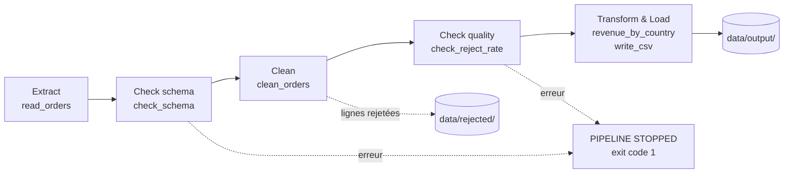

# DataOps Lab 1 : d'un script fragile à un pipeline testé


Pipeline de données qui calcule le chiffre d'affaires par pays à partir des commandes quotidiennes d'une boutique en ligne, avec **contrôles qualité**, **quarantaine des lignes rejetées**, **tests unitaires** et **intégration continue**.

## Contexte

Un script lit chaque matin les commandes de la veille et calcule le chiffre d'affaires par pays. Il s'exécute sans erreur, mais ses chiffres sont faux : c'est une **erreur silencieuse**.

Sur le fichier du jour 1, le script naïf affiche **12 771,10** alors que le total correct est **7 655,90**, soit environ **66,8 % de trop**. La commande 1019 (un clavier facturé 4 500 au lieu de 45) explique à elle seule l'essentiel de l'écart.

Ce projet remplace le script par un pipeline qui refuse de publier des données douteuses.

## Architecture



| Étape | Fonction | Fichier |
|---|---|---|
| 1. Extract | `read_orders` | `pipeline/extract.py` |
| 2. Check schema | `check_schema` | `pipeline/validate.py` |
| 3. Clean | `clean_orders` | `pipeline/transform.py` |
| 4. Check quality | `check_reject_rate` | `pipeline/validate.py` |
| 5. Transform & load | `revenue_by_country`, `write_csv` | `pipeline/transform.py`, `pipeline/load.py` |

## Règles de qualité

| Règle | Dimension | Raison de rejet | Action |
|---|---|---|---|
| Pays : espaces et casse | Cohérence | : | Réparé (`strip` + `title`), la ligne est conservée |
| `customer_id` présent | Complétude | `missing_customer_id` | Ligne rejetée |
| Date réelle au format `YYYY-MM-DD` | Validité | `invalid_date` | Ligne rejetée |
| Quantité strictement positive | Validité | `invalid_quantity` | Ligne rejetée |
| Prix entre 0,01 et 1 000 | Validité | `invalid_unit_price` | Ligne rejetée |
| Un seul `order_id` (on garde le premier) | Unicité | `duplicate_order_id` | Ligne rejetée |
| Pays dans la liste des cinq pays de la boutique | Validité | `unknown_country` | Ligne rejetée |

Deux contrôles arrêtent tout le pipeline :

- **Schéma** : colonne obligatoire absente ou fichier vide.
- **Taux de rejet** : plus de 20 % des lignes rejetées (le problème vient alors du fichier, pas des lignes).

Les lignes rejetées sont écrites dans `data/rejected/rejected_orders.csv` avec leur motif, pour pouvoir corriger la source et les retraiter.

## Structure du projet

```
dataops-lab1/
├── .github/workflows/ci.yml   # intégration continue
├── data/raw/                  # fichiers de commandes (jours 1, 2, 3)
├── pipeline/
│   ├── extract.py
│   ├── validate.py
│   ├── transform.py
│   └── load.py
├── tests/test_pipeline.py     # tests unitaires pytest
├── naive_report.py            # ancien script (référence)
├── run_pipeline.py            # point d'entrée du pipeline
├── requirements.txt
└── REPORT.md                  # ..
```

## Installation

Prérequis : Python 3.9 ou plus récent, Git.

**Windows (PowerShell)**
```powershell
git clone https://github.com/SaraBouguerra12/dataops-lab1.git
cd dataops-lab1
py -m venv .venv
.venv\Scripts\Activate.ps1
pip install -r requirements.txt
```

**macOS / Linux**
```bash
git clone https://github.com/SaraBouguerra12/dataops-lab1.git
cd dataops-lab1
python3 -m venv .venv
source .venv/bin/activate
pip install -r requirements.txt
```

## Utilisation

```bash
python run_pipeline.py data/raw/orders_day1.csv
```

Sorties :

- `data/output/revenue_by_country.csv` : chiffre d'affaires par pays
- `data/rejected/rejected_orders.csv` : lignes rejetées et leur motif
- code de sortie `0` en cas de succès, `1` si le pipeline s'arrête

Comparaison avec l'ancien script :

```bash
python naive_report.py data/raw/orders_day1.csv
```

## Résultats sur les trois jours

| Fichier | Ancien script | Pipeline |
|---|---|---|
| Jour 1 : données sales | Total faux : 12 771,10 | 25 lignes propres, 5 rejetées, total correct : **7 655,90** |
| Jour 2 : prix multipliés par 100 | Total faux sans aucune erreur : 270 200,0 | Arrêt : taux de rejet de 100 %, rien n'est publié |
| Jour 3 : colonne `unit_price` renommée `price` | `KeyError` | Arrêt : `Missing columns: ['unit_price']` |

Quand le pipeline s'arrête, le dernier rapport publié reste celui du jour 1 : **aucune donnée fausse n'est diffusée**.

## Tests

```bash
python -m pytest
```

6 tests unitaires sur de petites tables construites à la main : calcul du chiffre d'affaires, rejet des quantités négatives, rejet des doublons, normalisation des pays, arrêt sur colonne manquante, rejet des pays inconnus.

## Intégration continue

Le workflow GitHub Actions (`.github/workflows/ci.yml`) s'exécute à chaque `push` et `pull_request` :

1. installation des dépendances,
2. exécution des tests `pytest`,

Un test cassé fait passer le badge en rouge.

## Pratiques DataOps illustrées

| Pratique | Mise en œuvre |
|---|---|
| Reproductibilité | Environnement virtuel et `requirements.txt` |
| Contrôle de version | Git, `.gitignore` (on versionne le code, pas ses productions) |
| Tests de données | Contrôle du schéma, règles de qualité, taux de rejet |
| Tests de code | pytest |
| Arrêt de la ligne | Le pipeline refuse de publier des données douteuses |
| Intégration continue | GitHub Actions |

Pistes non couvertes : **orchestration** (lancement automatique) et **monitoring** (alerte quand le pipeline s'arrête).

## Pistes d'amélioration

- Valider que le pays appartient à la liste des cinq pays de la boutique.
- Journaliser chaque exécution (date, fichier, lignes propres, lignes rejetées).
- Planifier l'exécution quotidienne avec un orchestrateur et envoyer une alerte en cas d'échec.

## Versionnement des données avec DVC

Les données brutes (`data/raw/`) ne sont pas dans Git. DVC les versionne : Git ne garde que le pointeur `data/raw.dvc`, qui contient l'empreinte md5 du dossier. Les fichiers eux-mêmes sont stockés dans le remote DVC, sous le nom de leur empreinte.

| Version | Tag Git | Contenu | Total du rapport |
|---|---|---|---|
| 1 | `data-v1` | 30 commandes du 5 octobre | 7 655,90 |
| 2 | `data-v2` | + 5 commandes en retard | 8 835,40 |

Revenir à une ancienne version des données :

```bash
git checkout data-v1 -- data/raw.dvc
dvc checkout
python run_pipeline.py data/raw/orders_day1.csv   # TOTAL: 7655.90

git checkout HEAD -- data/raw.dvc
dvc checkout                                       # retour à la dernière version
```

Il faut toujours enchaîner `git checkout ... data/raw.dvc` et `dvc checkout`. Sans `dvc checkout`, le pointeur annonce une version et les fichiers en contiennent une autre : le rapport est faux sans aucune erreur.

Récupérer les données dans un clone : `dvc pull`. Dans ce projet pédagogique, le remote DVC est un dossier local (`../dvc-storage`), donc `dvc pull` ne fonctionne que sur la machine qui le possède. En entreprise, on utilise S3, Google Drive ou un serveur partagé.

Le rapport est décrit comme une étape DVC (`dvc.yaml`, `dvc.lock`) : `dvc repro` ne relance le pipeline que si le code ou les données ont changé.

## Auteur

Sarra Bouguerra : étudiante en 5e année d'ingénierie, spécialité Data Science
